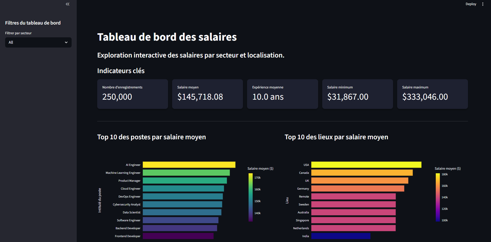

# BigDataProject

> A containerised big data pipeline that moves a 250,000-row salary dataset through
> HDFS and Apache Spark, serves the analytics through an interactive Streamlit
> dashboard, and runs a classic Hadoop Streaming MapReduce job over retail
> transaction data.


## Preview



*Streamlit dashboard reading the salary dataset from HDFS through Spark.*

## Overview

BigDataProject stands up a real distributed stack on a single machine: a Hadoop
cluster (HDFS + YARN) and an Apache Spark cluster, both orchestrated with Docker
Compose. Two independent workloads run on top of it:

- **Salary analytics** — a 250,000-row job-salary CSV is stored in HDFS, analysed
  with PySpark (KPIs, grouped aggregations, distribution statistics), and made
  explorable through a Streamlit/Plotly dashboard.
- **Retail MapReduce** — a Hadoop Streaming job implements the classic
  word-count pattern to count sales per city over a tab-separated transaction log.

## Architecture

```text
docker compose up
        |
        v
+------------------------------------------------+
| Hadoop cluster (HDFS + YARN)                   |
|   namenode  -  3x datanode                     |
|   resourcemanager  -  3x nodemanager           |
|   historyserver                                |
+------------------------------------------------+
+------------------------------------------------+
| Spark cluster                                  |
|   spark-master  -  3x spark-worker             |
+------------------------------------------------+
        |
        v
  hdfs://namenode:9000/datasets/
        |
        +--> spark.py           KPIs + aggregations --> Parquet
        +--> app.py             Streamlit dashboard
        +--> mapper / reducer   sales per city (MapReduce)
```

Details of the topology, ports and data flow are in
[`docs/architecture.md`](docs/architecture.md).

## Highlights

- 12-container Hadoop + Spark cluster defined in a single `docker-compose.yml`.
- The Spark job reads the raw CSV from HDFS and writes the aggregation results
  back to HDFS as Parquet.
- Interactive Streamlit/Plotly dashboard: KPIs, top-N rankings, salary
  distribution, remote-work and certification analysis.
- Classic MapReduce word-count pattern implemented with Hadoop Streaming.
- `make` targets and a pinned `requirements.txt` make the whole flow reproducible.
- Unit tests for the mapper and reducer run in CI without a cluster.

## Tech stack

| Layer               | Technology                                        |
| ------------------- | ------------------------------------------------- |
| Language            | Python 3.11                                       |
| Distributed storage | HDFS 3.2.1 (bde2020 images)                       |
| Resource management | Hadoop YARN 3.2.1                                 |
| Distributed compute | Apache Spark 3.5.1 (PySpark)                      |
| Dashboard           | Streamlit + Plotly (Express / Graph Objects)      |
| Data frames         | pandas                                            |
| Batch processing    | Hadoop Streaming (mapper.py / reducer.py)         |
| Orchestration       | Docker Compose                                    |
| Quality             | pytest, ruff, GitHub Actions                      |

## Getting started

```bash
make up         # start the Hadoop + Spark cluster
make put-data   # upload the datasets into HDFS
make spark      # run the PySpark batch analysis
make dashboard  # open the dashboard on http://localhost:8501
```

Run `make help` to list every target. Full instructions, exposed ports and
troubleshooting live in [`docs/usage.md`](docs/usage.md).

## Project layout

```text
bigdata/
|-- app.py                      Streamlit salary dashboard
|-- spark.py                    PySpark batch analysis (writes Parquet to HDFS)
|-- mapper.py / reducer.py      Hadoop Streaming MapReduce job
|-- docker-compose.yml          Hadoop + Spark cluster definition
|-- Makefile                    Convenience targets for the whole flow
|-- requirements.txt            Pinned runtime dependencies
|-- purchases.txt               Retail transaction dataset (~15 MB)
|-- datasets/
|   |-- job_salary_prediction_dataset.csv   Salary dataset (~17 MB, 250K rows)
|-- docs/                       Architecture, usage, datasets, MapReduce notes
|-- tests/                      Unit tests for the mapper and reducer
|-- BigDataProject_Rapport.pdf  Project report (French)
```

## Datasets

| Dataset | Rows | Description |
| ------- | ---- | ----------- |
| `job_salary_prediction_dataset.csv` | 250,000 | Tabular salary data with 10 columns (job title, experience, education, skills, industry, company size, location, remote work, certifications, salary). |
| `purchases.txt` | 308,103 | Tab-separated retail transactions: date, time, city, category, amount, payment method. |

The salary dataset comes from the public Kaggle dataset
[Job Salary Prediction Dataset](https://www.kaggle.com/datasets/nalisha/job-salary-prediction-dataset)
by `nalisha`. Column-level detail is in [`docs/datasets.md`](docs/datasets.md).

## Documentation

- [`docs/architecture.md`](docs/architecture.md) — topology, ports, data flow.
- [`docs/usage.md`](docs/usage.md) — setup, run commands, troubleshooting.
- [`docs/datasets.md`](docs/datasets.md) — dataset schemas and provenance.
- [`docs/mapreduce.md`](docs/mapreduce.md) — MapReduce design and results.
- `BigDataProject_Rapport.pdf` — full project report (French).

## Roadmap

- Replace the inferred schema with an explicit one and add data-quality checks.
- Expose the saved Parquet aggregations as Spark SQL views for the dashboard.
- Parameterise cluster size and resource limits through environment variables.
