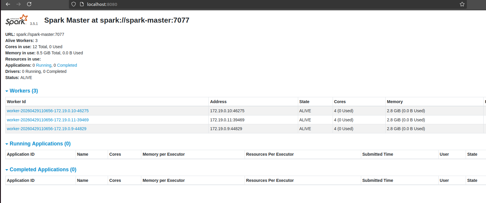

# Architecture

## Cluster topology

Everything is orchestrated by `docker-compose.yml`, which starts a Hadoop cluster
(HDFS + YARN) and a Spark cluster on a single Docker bridge network (`hadoop`).

| Service           | Image                                   | Purpose                     | Host port |
| ----------------- | --------------------------------------- | --------------------------- | --------- |
| `namenode`        | `bde2020/hadoop-namenode:2.0.0-…`       | HDFS metadata + Web UI      | 9870, 9000 |
| `datanode1..3`    | `bde2020/hadoop-datanode:2.0.0-…`       | HDFS block storage          | —         |
| `resourcemanager` | `bde2020/hadoop-resourcemanager:2.0.0-…`| YARN scheduler + Web UI     | 8088      |
| `nodemanager1..3` | `bde2020/hadoop-nodemanager:2.0.0-…`    | YARN container execution    | —         |
| `historyserver`   | `bde2020/hadoop-historyserver:2.0.0-…`  | MapReduce job history UI    | 19888     |
| `spark-master`    | `apache/spark:3.5.1`                    | Spark master + dashboard    | 7077, 8080, 8501 |
| `spark-worker-1..3` | `apache/spark:3.5.1`                  | Spark executors (4 cores / 2.8 GiB each) | — |

Web UIs once the cluster is up:

- HDFS — <http://localhost:9870>
- YARN — <http://localhost:8088>
- MapReduce history — <http://localhost:19888>
- Spark master — <http://localhost:8080>
- Streamlit dashboard — <http://localhost:8501>



*The Spark master UI showing the three registered workers.*

## Volume mounts

| Container      | Host path | Container path | Purpose                       |
| -------------- | --------- | -------------- | ----------------------------- |
| `namenode`     | `./data`  | `/data`        | Datasets uploaded into HDFS   |
| `spark-master` | `./data`  | `/data`        | Datasets available to Spark   |
| `namenode`     | `.`       | `/opt/project` | Streaming jobs (`streaming/`) |
| `spark-master` | `.`       | `/opt/project` | Analysis + dashboard sources  |

The project root is mounted read-only-by-convention at `/opt/project` so the
Streaming and Spark commands can point at the source files directly.

## HDFS layout

```text
/datasets/
    job_salary_prediction_dataset.csv   uploaded from ./data
    purchases.txt                       uploaded from ./data
    analytics/                          Parquet outputs written by the analysis job
        kpis/
        salary_by_job_title/
        salary_by_location/
        ...
/output/                                MapReduce output (sales per city)
```

## Data flow

### Salary analytics

```text
data/job_salary_prediction_dataset.csv (local)
        |
        v  make put-data
HDFS /datasets/job_salary_prediction_dataset.csv
        |
        |  analysis/salary_analysis.py  -> cast + drop null salaries
        v
aggregations (job title, location, education, industry, remote work, ...)
        |
        +--> printed to the console
        +--> written to HDFS /datasets/analytics/*.parquet
        |
        v
dashboard/app.py (Streamlit) reads the CSV from HDFS and renders the dashboard
```

### Retail MapReduce

```text
data/purchases.txt (tab-separated)
      |
      v  Hadoop Streaming
streaming/mapper.py   (city, 1)
      |
      v  shuffle + sort by city
streaming/reducer.py  (city, total_sales)
      |
      v
HDFS /output/part-*  -> copied into docs/mapreduce.md as an example
```

Processing notes:

- `analysis/salary_analysis.py` and `dashboard/app.py` both read from
  `hdfs://namenode:9000/...`; the HDFS name node is resolved by the Docker
  network DNS, not by an IP.
- The dashboard loads and cleans the dataset once per session; every widget then
  runs against that cached Spark DataFrame.

## Resource requirements

- Docker with at least **8 GB** of RAM available to the engine.
- Capacity for **12 containers** simultaneously.
- Roughly **3 GB** of disk for images and datasets on first pull.
