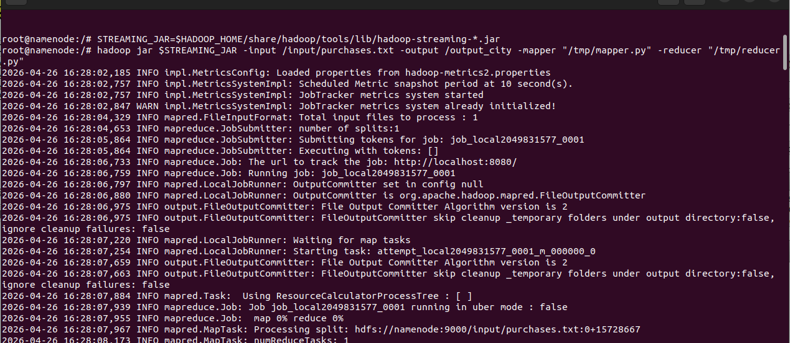

# MapReduce job

The MapReduce workload implements the classic **word-count** pattern with Hadoop
Streaming: it counts how many transactions occurred per city in `purchases.txt`.

## Input and output

- **Input:** HDFS `/datasets/purchases.txt` (tab-separated, 308,103 rows).
- **Output:** HDFS `/output/part-*`, one `city<TAB>count` line per city.

## Mapper (`mapper.py`)

For every line the mapper splits on tabs, takes the **city** (field 3) and emits
`city<TAB>1`. Lines with fewer than three fields are ignored.

```python
for line in sys.stdin:
    parts = line.strip().split("\t")
    if len(parts) >= 3:
        print("{}\t1".format(parts[2].strip()))
```

## Reducer (`reducer.py`)

Hadoop sorts the mapper output by key before the reduce phase, so identical
cities arrive consecutively. The reducer sums the run of equal keys and flushes
the total when the key changes (and once more at the end of the stream).

```python
if current_key == key:
    current_sum += value
else:
    if current_key:
        print("{}\t{}".format(current_key, current_sum))
    current_key, current_sum = key, value
```

Because the reducer relies on sorted input, it is only ever correct in the
reduce phase — the shuffle/sort step is what makes it work.

## Running it

```bash
make mapreduce
```

```bash
docker exec namenode hdfs dfs -rm -r -f /output
docker exec namenode yarn jar \
  /opt/hadoop-3.2.1/share/hadoop/tools/lib/hadoop-streaming-3.2.1.jar \
  -input /datasets/purchases.txt \
  -output /output \
  -mapper  "python3 /opt/project/mapper.py" \
  -reducer "python3 /opt/project/reducer.py"
```

## Result

The job reduces 308,103 transactions into **103 cities**. Top 10 by number of
transactions:

| Rank | City             | Transactions |
| ---- | ---------------- | -----------: |
| 1    | Colorado Springs |        3,102 |
| 2    | Glendale         |        3,098 |
| 3    | Cleveland        |        3,082 |
| 4    | Sacramento       |        3,078 |
| 5    | Tucson           |        3,078 |
| 6    | Virginia Beach   |        3,072 |
| 7    | Omaha            |        3,071 |
| 8    | Miami            |        3,069 |
| 9    | Lincoln          |        3,068 |
| 10   | Dallas           |        3,067 |



## Tests

The mapper and reducer are pure stdin/stdout programs, so they are unit tested
without a cluster:

```bash
make test
```

`tests/test_mapreduce.py` covers malformed-line handling, multi-group reduction
and the full mapper -> sort -> reducer pipeline.
