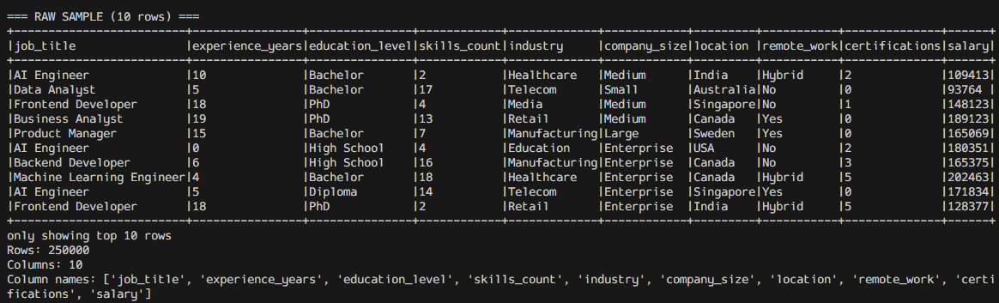

# Usage

## Prerequisites

- Docker with **at least 8 GB** of RAM assigned to the engine.
- Docker Compose v2 (`docker compose`).
- `make` (optional). On Windows, run the raw commands below or use WSL / Git Bash.

## Start and stop the cluster

```bash
make up        # docker compose up -d
make down      # docker compose down
make logs      # docker compose logs -f
```

The first run pulls several images, so allow a few minutes. Once the cluster is
healthy, the web UIs are available on the ports listed in
[`architecture.md`](architecture.md).

## Upload the datasets into HDFS

```bash
make put-data
```

which is equivalent to:

```bash
docker exec namenode hdfs dfs -mkdir -p /datasets
docker exec namenode hdfs dfs -put -f /opt/project/data/job_salary_prediction_dataset.csv /datasets/
docker exec namenode hdfs dfs -put -f /opt/project/data/purchases.txt /datasets/
```

## Run the Spark batch analysis

```bash
make spark
```

```bash
docker exec spark-master /opt/spark/bin/spark-submit \
  --master spark://spark-master:7077 /opt/project/analysis/salary_analysis.py
```

The job prints the schema, the KPIs and every aggregation, then writes the
results to `hdfs://namenode:9000/datasets/analytics/<name>` as Parquet.



## Run the MapReduce job

```bash
make mapreduce
```

```bash
docker exec namenode hdfs dfs -rm -r -f /output
docker exec namenode yarn jar \
  /opt/hadoop-3.2.1/share/hadoop/tools/lib/hadoop-streaming-3.2.1.jar \
  -input /datasets/purchases.txt \
  -output /output \
  -mapper  "python3 /opt/project/streaming/mapper.py" \
  -reducer "python3 /opt/project/streaming/reducer.py"
```

## Launch the Dashboard

```bash
make deps        # install streamlit/plotly/pandas inside spark-master (once)
make dashboard   # streamlit run /opt/project/dashboard/app.py
```

Then open <http://localhost:8501>.

## Make targets

| Target       | Description                                          |
| ------------ | ---------------------------------------------------- |
| `up`         | Start the Hadoop + Spark cluster.                    |
| `down`       | Stop the cluster and remove the containers.          |
| `logs`       | Tail the logs of all services.                       |
| `deps`       | Install the Python runtime dependencies.             |
| `put-data`   | Upload both datasets into HDFS.                      |
| `spark`      | Run the PySpark batch analysis.                      |
| `mapreduce`  | Run the Hadoop Streaming job.                        |
| `dashboard`  | Launch the Streamlit dashboard.                      |
| `lint`       | Run `ruff` against the Python sources.               |
| `test`       | Run the unit tests.                                  |
| `clean`      | Stop the cluster and delete generated caches.        |

## Troubleshooting

- **A port is already in use.** 9870/9000/8088/19888/7077/8080/8501 must be free.
  Stop the conflicting process or edit the published ports in
  `docker-compose.yml`.
- **`make up` is slow / containers restart.** The Hadoop images need the full
  8 GB; increase the memory assigned to Docker and re-run.
- **`hdfs dfs` commands fail right after startup.** The name node may still be
  leaving safe mode. Wait for <http://localhost:9870> to show the node as live,
  then retry `make put-data`.
- **The MapReduce job fails with `python3: not found`.** Hadoop Streaming runs
  the mapper on a node manager container, which must have `python3` on its PATH.
- **`streamlit: command not found`.** Run `make deps` before `make dashboard`.
- **The dashboard shows "Could not read the dataset from HDFS".** Start the
  cluster (`make up`), upload the data (`make put-data`), then reload the page.
